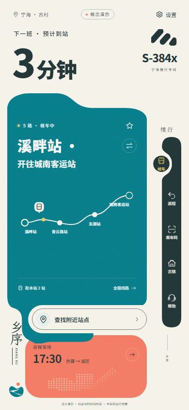
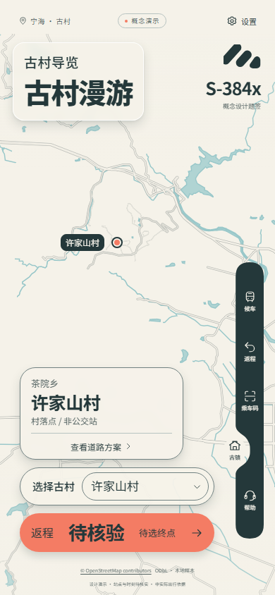

# 六色主题 · 2.1.1

日期：2026-10-16。基于 `4d883cce6100714b7221ca8edef906c08e53af9d`（2.1.0）。本轮只调整配色及其必要的文字透明度，保留原 UI 的尺寸、结构、字体、导航曲线和所有操作流程。

## 改动范围

- `src/mobile/palette.css` 集中定义用户六色、深浅文字及边线，并处理不同底色上的可读性。
- 活跃的 `transit.css`、`single-screen.css`、`groove-navigation.css`、`accessibility.css`、`town-scene.css`、`ui-motion.css` 与 `TransitArt.tsx` 使用统一色值。
- `src/geography/map-depth.ts` / `.css` 同步地图底色、水系、道路、村落标记及研究路线。几何、相机、数据、线宽和动效不变。
- 浏览器主题色、图标和版本信息同步更新；历史设计资料没有覆盖。

## 配色可读性

| 搭配 | 对比度 |
| --- | --- |
| 纯白小字 / 海湾青 | 4.75:1 |
| 瓦影墨 / 灯花橙 | 4.65:1 |
| 花田黄 / 瓦影墨 | 7.79:1 |
| 瓦影墨 / 石米白 | 11.02:1 |
| 瓦影墨 / 雾青 | 10.51:1 |

海湾青与石米白只有4.24:1，因此海湾青内容区的小字使用纯白辅助色。橙色按钮采用墨字；半透明说明字恢复不透明，保持小字清晰。凹槽导航沿用原结构与480ms过渡，普通页面墨底黄字选中，古村页米白圆座配墨字。

浏览器抽查八个普通页面和设置面板的251个可见文本节点，按实际计算颜色、祖先透明度与底色检查；导航 SVG 底座及字号滑块伪元素单独解析。未发现低于对应文字阈值的节点。此项是当前场景抽查，不代表完整无障碍认证；不包含真机显示差异、所有网络异常或所有动态中间帧。

## 本轮验证

- 类型检查、生产构建与35项现有单元/数据检查通过。既有单测中的旧主题对比度常量不作为本次新配色的验收依据。
- 生产子路径下八个页面、地图与字体资源，以及选村、研究返程、保存和刷新恢复完整链路通过。
- 页面动效11/11、导航过渡11/11、配色与布局12/12通过；使用现有脚本独立副本，仅更改结果输出目录。
- 390普通/老年模式、320大字号及1440桌面检查无页面横纵溢出、无未捕获JavaScript错误。

更多浏览器结果和本轮截图位于 [palette-v2.1.1](palette-v2.1.1/)。实际手机设备测试未运行。

| 候车 | 古村 |
| --- | --- |
|  |  |
