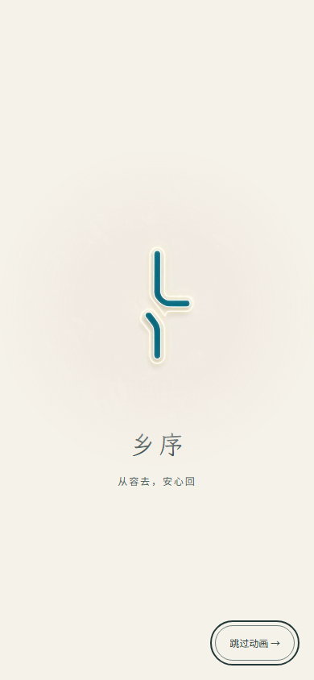
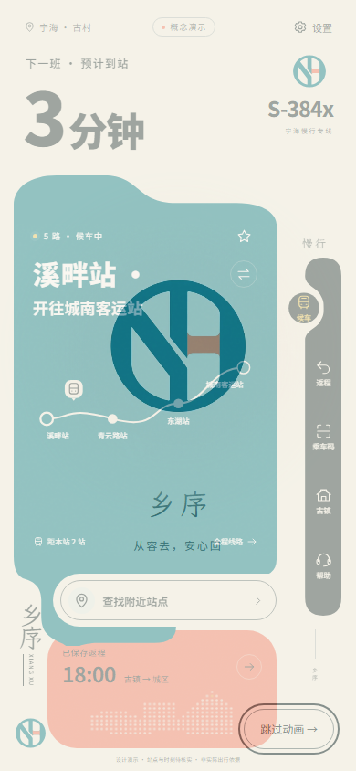
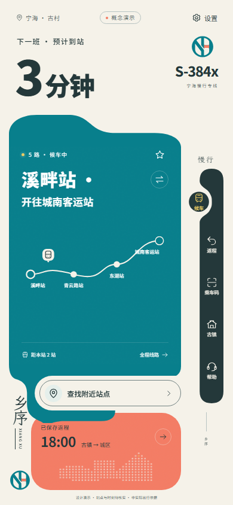

# NH 徽标与启动动画验收 · v2.2.0

日期：2026-10-18。范围：品牌资产、启动层、现有界面品牌引用；原布局、字号、业务状态、地图和导航动效保持原样。

## 资源与衔接

- `public/brand/nh-logo.svg` 按用户提供图片顶部的主徽标描摹为透明矢量路径，使用现有海湾青 `#087F8C` 与灯花橙 `#F47C64`；`nh-logo-mono.svg` 提供同轮廓单色版本。
- 原始 `宁海NH圆形徽标.png` 保持不变。主徽标未包含图片底部三种配色展示区域。
- `public/brand/nh-launch.mp4` 为用户原始视频的逐字节复制：960×960、4.041667秒、1,488,145字节。SHA-256：`62616b47c01eb66c1576ab3d9eb0d4a78d932f44f09cf1dc749961c8bb97d453`。
- 视频静音内联播放；以柔和边缘蒙版融入石米白背景。画面结束后保留解码末帧，启动层和已挂载页面交叉淡入淡出640ms，完成后移除视频和启动层。
- 正常无路径启动进入原首页；直接打开 `#/town` 等链接保留目的页面。`sessionStorage` 记录当前标签页会话已完成状态，切换页面与同标签刷新不重播。
- 启动层提供44px以上的跳过按钮、Escape快捷跳过与键盘焦点约束；底层使用 `inert` 和 `aria-hidden`，淡入结束才恢复操作并把焦点交给主内容。
- 系统减少动态效果、应用安静模式、老年模式跳过启动并不请求MP4。播放中切换系统设置会立即结束启动。
- 自动播放拒绝、视频错误、无进度超过2600ms或播放总期限超过8500ms，都经过静态徽标进入页面；计时器包含250ms检查间隔、180ms静态停留和640ms退场。会话存储写入失败也不阻止进入应用。

## 检查结果

| 检查 | 结果 |
| --- | --- |
| TypeScript类型检查 | 通过 |
| 现有单元与数据测试 | 35/35通过 |
| Vite生产构建 | 通过；沿用既有MapLibre体积提示 |
| 启动专项浏览器验证 | 15/15通过，0未捕获JS错误 |
| 既有页面及导航动效 | UI动效11/11、凹槽导航11/11通过；导航测试等待启动完成后采样 |
| 真实媒体播放 | 收到浏览器可信 `ended`；时间达到4.041667秒，16次可信进度事件 |
| 淡入过程与焦点 | 约650ms、39帧采样，底层保持inert至结束；焦点回到main-view |
| 小屏与大屏 | 320×568大字号、390×844、1440×900无页面溢出 |
| 同标签刷新、页面切换、古镇深链 | 无重播；保留目的页面 |
| 系统减少动态效果、应用安静模式、老年模式 | 三种模式均0视频元素、0视频请求 |
| 请求失败、自动播放拒绝 | 约967ms恢复页面 |
| 请求挂起 | 约3717ms恢复页面 |
| 持续进度但永不结束的故障模拟 | 约9466ms触发总期限并恢复页面 |
| 会话存储写入失败 | 跳过、操作与内存内无重播均通过 |
| 播放中启用系统减少动态效果 | 立即进入页面，实测小于550ms |
| 生产子路径部署 | 八页面、字体和地图资源、研究返程保存恢复通过；首次自然播放结束通过 |

浏览器为本机 Edge 独立临时配置，未更改用户浏览器偏好。启动报告为 [startup-v2.2.0/test-results.json](startup-v2.2.0/test-results.json)，生产报告为 [startup-v2.2.0/production-results.json](startup-v2.2.0/production-results.json)。既有动效回归记录为 [ui-motion-results.json](startup-v2.2.0/ui-motion-results.json) 与 [navigation-results.json](startup-v2.2.0/navigation-results.json)。

运行 `pnpm test:startup` 可复测启动行为，输出到忽略目录 `.delivery/nh-launch/`；也可通过 `PREVIEW_URL` 指定预览路径、`PLAYWRIGHT_CHANNEL` 指定浏览器。

## 实际截图

