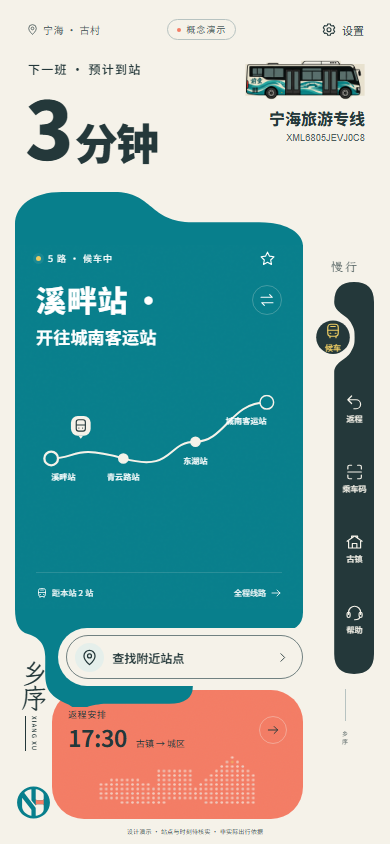
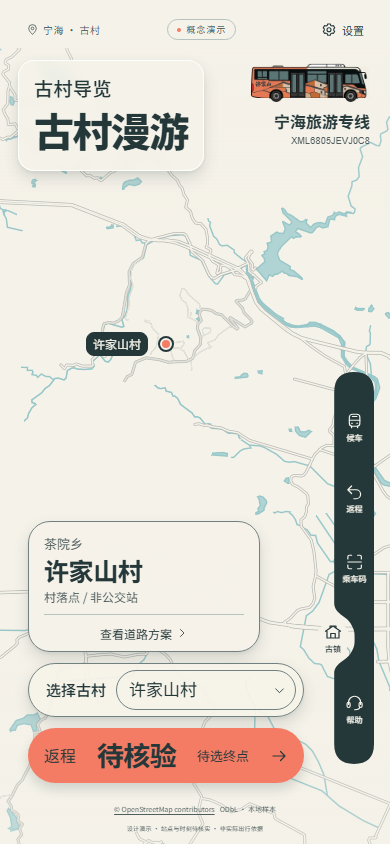

# 主题巴士与每次启动验收 · v2.2.1

日期：2026-10-18。仅调整右上角线路标识和启动策略，保留现有版式、地图、字体设置、右侧导航和业务操作。

## 右上角主题巴士

右上角从前童、许家山、龙宫、力洋四款主题巴士中随机选择一款，每次完整打开应用重新选择。四款等概率，可以连续抽中同款；当前打开期间的页面切换、选村和设置不会重新抽取。

主标题为“宁海旅游专线”，下方车型为“XML6805JEVJ0C8”。首页与古镇页共用同一选择，保留原线路按钮功能。车票、应用签名、老年模式和浏览器图标保留NH品牌徽标。

`public/brand/town-buses.png` 为用户提供四镇主题车图的原始文件，没有重绘或改动像素。通过SVG视窗与剪裁区显示单辆车，原图标题、序号及邻车不进入页面；背景使用混合效果融入原石米白底色。原图SHA-256：`12bfc677e5a4290b697617cd6ee455549a3dd1c45a5640bfccd29851302ba033`，1,422,312字节。

`ThemeBus.tsx` 集中管理四款视窗，`TransitApp.tsx` 初始化一次随机选择并传递至 `TownScene.tsx`；不会把随机主题当作实际班次或地图目的地。文字继续响应小/中/大字号，320px屏幕下缩小标识区的基础尺寸以保留标题空间。

## 每次启动

每次完整打开、刷新或新标签页均播放原始4.041667秒视频，正常结束后用640ms交叉淡入衔接已有页面。删除会话完成记忆、跳过按钮和Escape跳过逻辑。页面内导航不会重播；古镇等深链接保留原目的页。

启动层接受键盘焦点，Tab不会进入被inert隔离的底层。自然结束后移除隔离并恢复主内容焦点。按用户要求，系统减少动态效果、应用安静模式和老年模式也播放完整视频，仅缩短末尾转场。

视频原文件不变。无法自动播放、加载错误或长时间没有进度时仍自动进入应用；该故障恢复不提供用户跳过入口。保留原来的2600ms无进度检查和8500ms总期限，避免启动层永久阻塞。

## 验证

- 类型检查、生产构建通过；现有单元和数据测试35/35通过。
- 启动专项15/15通过：真实可信ended、完整4.041667秒、约667ms转场、刷新和新标签页重播、无跳过入口、Escape不跳过、焦点恢复、三类减少动态效果模式完整播放、异常恢复。
- 主题巴士专项13/13通过：四个随机分支、原图SHA、单辆显示、准确文字、跨页稳定、原按钮功能、其他NH徽标保留、0未捕获JS错误。
- 布局覆盖320×568大字号、360×780大字号、390×844中/大字号、430×932中字号、1440×900中字号；每种尺寸检查候车、返程、乘车码、车票、古镇、帮助，共36个页面状态，无新增标题重叠或视口溢出。
- 生产项目子路径检查通过：八页面、字体/视频/巴士资源、五个地图点、选村及研究返程保存/刷新恢复；刷新自然播完启动视频。
- 原UI动效检查11/11通过，包括大字号、快速导航、弹层退出、减少动态效果和老年模式操作。

报告：[启动专项](bus-v2.2.1/startup-results.json)、[主题巴士与布局](bus-v2.2.1/theme-bus-results.json)、[生产子路径](bus-v2.2.1/production-results.json)、[原UI动效](bus-v2.2.1/ui-motion-results.json)。运行 `pnpm test:startup`、`pnpm test:theme-bus` 可复测，输出位于忽略目录 `.delivery/bus-v221/`。现有动效、研究行程与生产检查脚本增加等待启动完成，原业务断言保持不变。

## 实际截图

| 前童 | 许家山 | 龙宫 | 力洋 |
| --- | --- | --- | --- |
|  |  |  |  |

